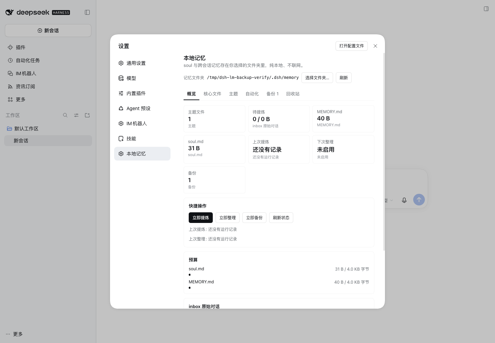
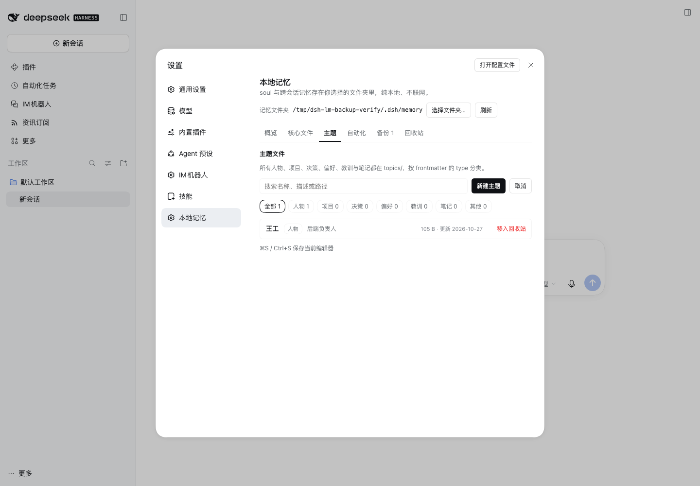
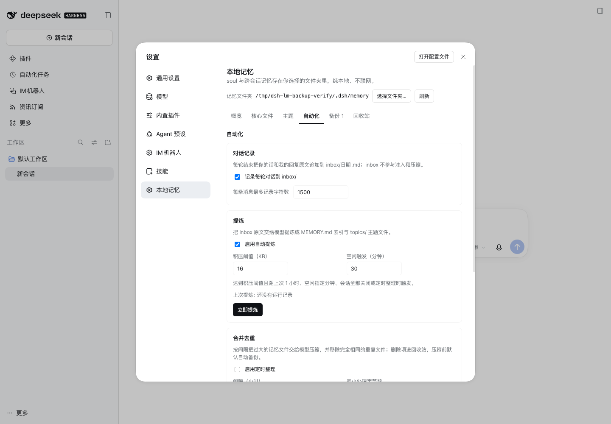
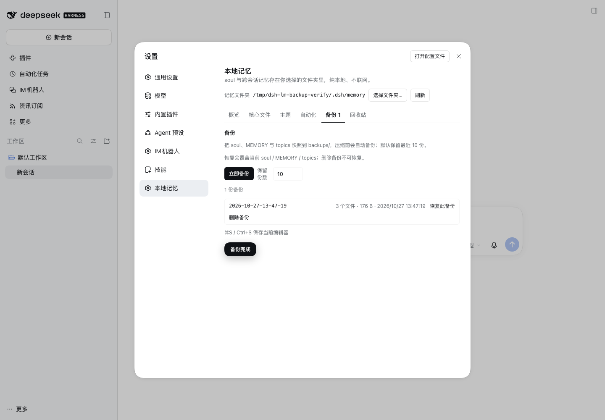

# dsh-local-memory

DeepSeek Harness 的纯本地长期记忆插件：一个普通文件夹，四层 Markdown，没有数据库、没有网络请求。

- **soul**：人格与风格，注入 system prompt 靠前（默认 ≤4 KB）
- **MEMORY.md**：长期记忆索引，注入 system prompt 靠后（默认 ≤4 KB，超限截断）
- **topics/**：人物、项目、决策、偏好、教训、笔记，全部按 frontmatter 的 `type` 分类
- **inbox/**：每轮对话原文，不注入、不检索，提炼后归档

## 功能

### 记忆

- 每轮对话自动追加原文到 `inbox/YYYY-MM-DD.md`（可关闭）
- 手动或自动提炼：inbox → `MEMORY.md` 索引 + `topics/*.md`
- 提炼去重：同一天二次提炼追加“补充”，跨次索引行与主题正文按行去重
- 大 inbox 文件按预算分段提炼，剩余内容回写 inbox，不会卡死或丢失
- `memory` 工具：`search` / `read` / `write` / `list` / `delete`

### 整理

- 定时合并去重：完全相同文件进回收站、大文件交给模型压缩
- 压缩前自动备份（可关），备份保留份数可配置（默认 10）
- 提炼失败不归档原文，下次重试
- 归档同名加时间戳，绝不覆盖

### 设置页

- 概览：主题数、待提炼积压、预算进度、上次运行、下次整理、warning
- 核心文件：直接编辑 `soul.md` / `MEMORY.md`，实时字节预算，⌘S 保存
- 主题：搜索、按类型过滤、新建、编辑、移入回收站
- 自动化：对话记录、提炼、压缩、模型等全部参数
- 备份：创建、恢复、删除、保留份数
- 回收站：恢复（绝不覆盖同名）、彻底删除、清空

## 界面

设置页六个页签：概览、核心文件（soul / MEMORY 编辑器）、主题（搜索/新建/编辑/回收）、自动化、备份、回收站。









## 文件夹结构

```
<dir>/
├── soul.md
├── MEMORY.md
├── topics/<slug>.md
├── inbox/
│   ├── YYYY-MM-DD.md
│   └── archive/
├── backups/<timestamp>/...
└── .trash/<timestamp>/...
```

`backups/` 与 `.trash/` 不参与注入、检索、压缩。

## 主题文件格式

```md
---
name: 王工
description: 后端负责人，偏好 async 写法
type: person
updated: 2026-10-27
---

- 负责后端上线
- 偏好 async/await
```

`type` 取值：`person` / `project` / `decision` / `preference` / `lesson` / `note`。
旧版的 `people/`、`projects/` 等目录会在启动时自动迁入 `topics/`，类型写进 frontmatter。

## 提炼触发

- 积压 ≥ 阈值（默认 16 KB）且距上次 ≥ 1 小时
- 空闲达到设定分钟数（默认 30 分钟）
- 最后一个会话关闭
- 定时整理（默认 24 小时兜底）
- 设置页「立即提炼」

## 安装（本地 link）

`package.json` 里：

```json
"dependencies": { "dsh-local-memory": "link:/absolute/path/to/dsh-local-memory" }
```

并把 `dsh-local-memory` 加进 `dsh.profile.bundles`。改完 Host 代码需要重启 DSH；改前端后刷新页面（若宿主未热更新则同样重启）。

插件 Config：

```yaml
- insert:
    - id: local-memory
      name: dsh-local-memory
      config:
        dir: "~/.dsh/memory"
        soulFile: soul.md
        memoryFile: MEMORY.md
        maxMemoryBytes: 4096
```

设置页保存的目录优先于 `config.dir`。

## HTTP API

| Method | Path | 说明 |
|---|---|---|
| GET | `/api/local-memory/state` | 全部状态、主题元数据、备份、回收站、warning |
| GET/POST | `/api/local-memory/file` | 读文件 / 写 soul、MEMORY、`topics/*.md` |
| POST | `/api/local-memory/topic` | 新建主题 |
| POST | `/api/local-memory/delete` | 主题移入回收站 |
| GET/POST | `/api/local-memory/trash` | 列出 / restore / purge / empty |
| GET/POST | `/api/local-memory/backup` | 列出 / create / restore / delete |
| POST | `/api/local-memory/settings` | 合并保存设置 |
| POST | `/api/local-memory/distill` | 立即提炼 |
| GET/POST | `/api/local-memory/compact` | 立即整理 / 查询状态 |

所有路径都经过白名单：`inbox/`、`backups/`、`.trash/`、`..` 不可通过 Web 写入。

## 测试

```bash
node test/host.test.mjs
node test/client.test.mjs
```

- Host：桩 ctx + 真实 HTTP 路由 + 桩 llm，覆盖 capture、提炼、大文件、去重、备份、回收站、失败路径
- Client：最小 React 垫片渲染真实组件，覆盖概览、编辑保存、主题增删改、回收站、设置、备份

## 隐私

插件不发任何网络请求；只有你配置的模型调用会离开本机。文件都是普通 Markdown，可直接用编辑器、git 或 grep 管理。
